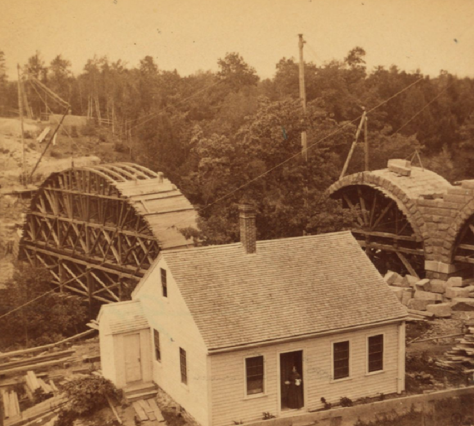

After many long years, it's finally landed, the [HoloFuel Network is live](https://netzero.zone/). 

In [this tweet](https://x.com/mbauwens/status/2117113911640289330) Michel Bauwens (founder of the [P2P Foundation](https://p2pfoundation.net/)) asks of a community member: "Can you explain … why this is such a milestone for you and the Holochain community?"   I want to take some time here on my personal blog to share why this event is momentous for me.

The first reason is pretty obvious and simple:  We set out to do something very difficult, in the "real world" and we actually did it.  Of course it feels good to have done it, but more importantly, to me personally, the goal is part of a set of larger goals that really matter to me. And now I can turn my attention to them.   I'm liberated into broader goals based on accomplishing this one!  What those are should be pretty clear to you if you take the time to read the other posts in this blog, which are a chronicle of the evolution of these goals.

This second reason this event feels momentous may be less obvious: It's about scaffolding.  Again, if you read these pages, my hope is for a post-monetary future.  But the challenge has always been: how do you get there? Mark Fisher's famous notion of [Capitalist Realism](https://en.wikipedia.org/wiki/Capitalist_Realism) is defined as "the widespread sense that not only is capitalism the only viable political and economic system, but also that it is now impossible even to imagine a coherent alternative to it."  Yet, it seems easier to me to imagine a different political economic system than it is to imagine a world in which people don’t use “money”. That is to say, imagining a post-monetary system is even more impossible. 

From my vantage point, it's clear that money operates as part of the body of society, it's the literal circulatory system of the social organism we call "society."   And that that circulatory system in its current form is deeply insufficient to keep the social body alive any more.  It cannot by its very structure, form, and operation, fulfill the needs that will keep the social organism alive, much less thriving.  Our current systems rely on hierarchies that land control in the hands of a few powerful people.  Despite the obvious everyday experience of the terrible consequences of these hierarchies of centralized power, they have at least one advantage: we can actually imagine how they work.   What we can't imagine is how a deeply decentralized system could possibly work and not just be chaos.

So given what seems like the impossibility of even imagining something else, how do you get there?   My answer: scaffolding.  It's long been a mystery how life could possibly exist.  How in the world could we have gone from non-living chemistry to fully self-replicating cells?  Even the simplest bacteria are amazingly complex systems.   My sense is that the right way to think about the steps between dead chemistry, and living cells must have been intermediary forms that "propped up" the complex chains of reactions that we call life, before they were fully complete, just like scaffolding holds up an arch which without it would fall down before it become self-standing.

Well, that's what HoloFuel is: scaffolding.  It's a working system that connects to the world’s current operating forms, while doing something new.  It both points to a new way of thinking about currencies in its ideation, but more importantly allows for practical building on top of that in new ways.   It's a small step, not the whole enchilada, but, like scaffolding, it supports, in the real world, not just as a toy, building of the new forms that will actually allow us to imagine a post-monetary future.

That is, for me, momentous.
